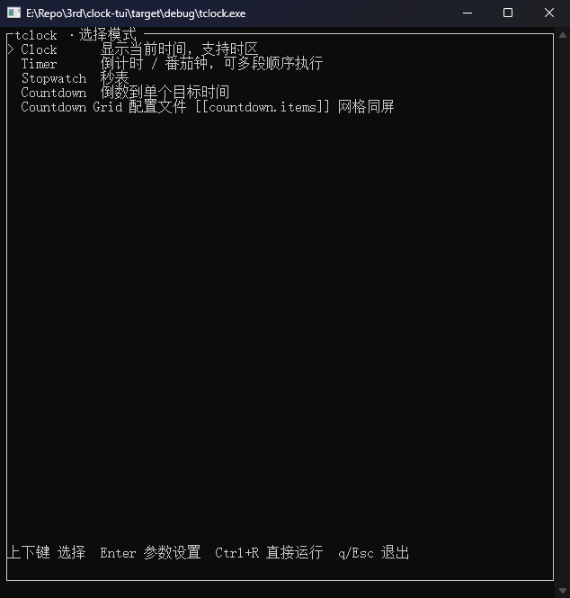
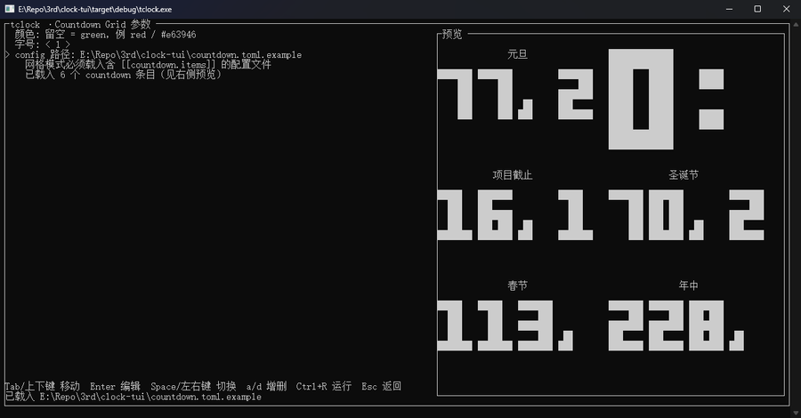
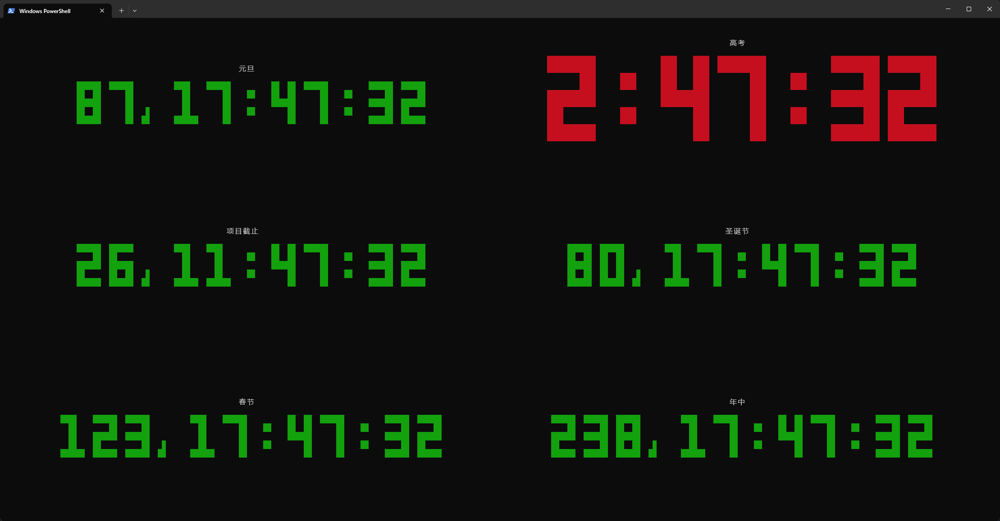

# clock-tui-ya (tclock)

> Yet another `clock-tui`. Independent fork of
> [race604/clock-tui](https://github.com/race604/clock-tui), based on upstream
> `v0.6.1` (= `97d7c02`). This fork is developed on its own: patches are not
> sent back upstream and upstream releases are not tracked, so the version
> numbering restarts at `0.1.0`.
> Upstream's original documentation is kept as-is in
> [README_ORI.md](./README_ORI.md).

## Interactive setup wizard

Run `tclock` with **no arguments** to open an interactive setup wizard:
pick a mode, edit its parameters with a live preview, then press `Ctrl+R`
to run. Pressing `q` inside a running mode returns to the wizard; pressing
`q` in the mode list exits.




- Mode list: `↑/↓` select, `Enter` open the parameter form, `Ctrl+R` run
  immediately with the current parameters, `q`/`Esc`/`Ctrl+C` quit.
  Single countdown and the config-file grid are two separate entries
  (**Countdown** / **Countdown Grid**) since their parameters conflict.
- Form: `Tab`/`↑/↓` move between fields, `Enter` edit, `Space`/`←/→` toggle
  or cycle, `a`/`d` add/remove list items, `Ctrl+R` run, `Esc` back
  (unsaved changes ask for confirmation).
- Every mode form also has the global fields: color, size and an optional
  `--config` path (loaded inline; **Countdown Grid** renders the file's
  `[[countdown.items]]` grid).
- The last successfully loaded config path is remembered in
  `tclock-wizard.toml` next to the executable and prefilled (and
  pre-loaded) on the next launch; clearing the field removes the file.
- Invalid parameters are flagged inline and block `Ctrl+R`.
- Wizard choices override the config file field-by-field.
- Anything on the command line (e.g. `tclock -c red`, `tclock timer -d 5m`)
  skips the wizard and behaves exactly as before.

## Multi-countdown mode

Configure multiple countdowns in a config file and display them all at once in a grid:



### Quick start

1. Copy the template [countdown.toml.example](./countdown.toml.example) to
   any path you like (e.g. `./my-countdown.toml`).
2. Edit the countdown entries.
3. Run with `--config`:

```shell
$ tclock countdown --config ./my-countdown.toml
```

Without `--config`, the modes work exactly as described in
[README_ORI.md](./README_ORI.md).

Press `q` to exit.

### Configuration

```toml
# Shared defaults (optional)
[countdown]
sort = "time"        # "time": nearest first | "config": file order
show_millis = false
reverse = false

[[countdown.items]]
time = "2027-01-01"
title = "New Year"
order = 1            # pin to a fixed grid position (1-based, row-major)
size = 3             # per-item size (>=1), falls back to the global size

[[countdown.items]]
time = "2026-10-05 09:00:00"
title = "Exam"
color = "red"        # per-item color, falls back to the global color
```

Supported `time` formats: `"20:00"`, `"20:00:30"`, `"2026-01-01"`,
`"2026-01-01 20:00:00"`, or RFC3339 like `"2026-01-01T20:00:00+08:00"`.

Per-item options: `title` (falls back to the time string), `order`, `color`,
`size`, `show_millis`, `reverse`. Items that fail to parse are skipped with a
warning instead of failing the whole config.

### Grid layout

| Countdowns | Layout            |
|------------|-------------------|
| 1          | fullscreen        |
| 2          | 2 rows            |
| 3 ~ 4      | 2x2 grid          |
| 5 ~ 6      | 3 rows x 2 cols   |
| 7 ~ 8      | 4x2 grid          |
| > 8        | truncated to 8 with a warning |

- Items with `order` occupy fixed positions; the rest fill free slots by the
  `sort` strategy. Order conflicts shift to the next free slot with a warning.
- The size is rendered exactly as configured (same as timer/clock mode);
  if a cell is too small the text is clipped, so keep `size` modest in grids.
- Durations longer than a day are shown as `87d 17:47:32`, with the `d`
  rendered at 1/3 of the digit size.
- A countdown that reaches zero freezes at all zeros (no blinking, no removal).

## Other modes

Clock, timer, stopwatch and single countdown modes work as before.
See [README_ORI.md](./README_ORI.md) for full usage.

# License

MIT License, refer to [LICENSE](./LICENSE) for detail.
